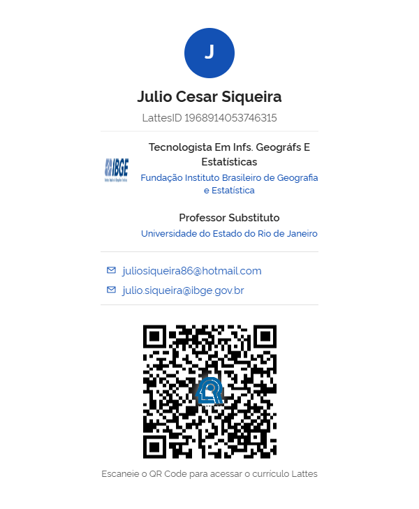

# Materiais didáticos — Prof. Julio C. Siqueira

Repositório público com os materiais das disciplinas ministradas pelo **Prof. Julio C. Siqueira**,
organizados por instituição e período letivo.

<p align="left">
  <a href="#apoie-este-projeto"></a>
  <a href="https://lattes.cnpq.br/1968914053746315"></a>
</p>

- Currículo Lattes: <https://lattes.cnpq.br/1968914053746315>
- Endereço deste repositório: <https://github.com/juliosiqueira86-dot/materiais-didaticos>

<div align="center">

<a href="https://lattes.cnpq.br/1968914053746315"></a>

</div>

---

## Apoie este projeto

<table>
  <tr>
    <td align="center" width="300">
      <br>
      <sub><b>Aponte a câmera do app do seu banco</b></sub>
    </td>
    <td>
      <h3>💚 Estes materiais te ajudaram?</h3>
      <p>
        Todo o conteúdo deste repositório é <b>aberto e gratuito</b>, e continuará sendo.
      </p>
      <p>
        Se os slides, listas e scripts foram úteis nos seus estudos, nas suas aulas ou no seu trabalho,
        considere uma <b>contribuição voluntária, de qualquer valor</b>, pelo Pix ao lado.
      </p>
      <p>
        Cada apoio ajuda a manter o repositório atualizado, a produzir novos materiais
        e a levar este acervo a mais estudantes.
      </p>
      <p><i>Obrigado por fazer parte desta construção coletiva do conhecimento.</i></p>
    </td>
  </tr>
</table>

<details>
<summary><b>Está no celular? Toque aqui para usar o Pix Copia e Cola</b></summary>

```
00020126580014br.gov.bcb.pix01367ebcfa65-c45b-4999-90aa-d80c1c7f38b65204000053039865802BR5920JULIO CESAR SIQUEIRA6009Sao Paulo62290525REC6B0483E9C348D1745922976304F6E0
```

Copie o código acima e cole na opção **Pix Copia e Cola** do aplicativo do seu banco.
</details>

---

## Instituições

| Instituição | Pasta |
|---|---|
| UERJ — Universidade do Estado do Rio de Janeiro | [UERJ](UERJ/) |
| Fiocruz — Fundação Oswaldo Cruz | [FIOCRUZ](FIOCRUZ/) |
| ENCE — Escola Nacional de Ciências Estatísticas (IBGE) | [ENCE](ENCE/) |
| UFRRJ — Universidade Federal Rural do Rio de Janeiro | [UFRRJ](UFRRJ/) |

## Como baixar um arquivo

1. Entre na pasta da instituição, do período e da disciplina.
2. Clique no PDF.
3. Clique no botão de download (seta para baixo, no canto superior direito da visualização) ou em **Raw**.

Não é preciso ter conta no GitHub para ver ou baixar os materiais.

## Uso dos materiais

Os slides são de autoria do Prof. Julio C. Siqueira e destinam-se ao uso didático. As obras de outros autores
citadas nos slides estão referenciadas nas bibliografias e não são redistribuídas aqui sem autorização.
